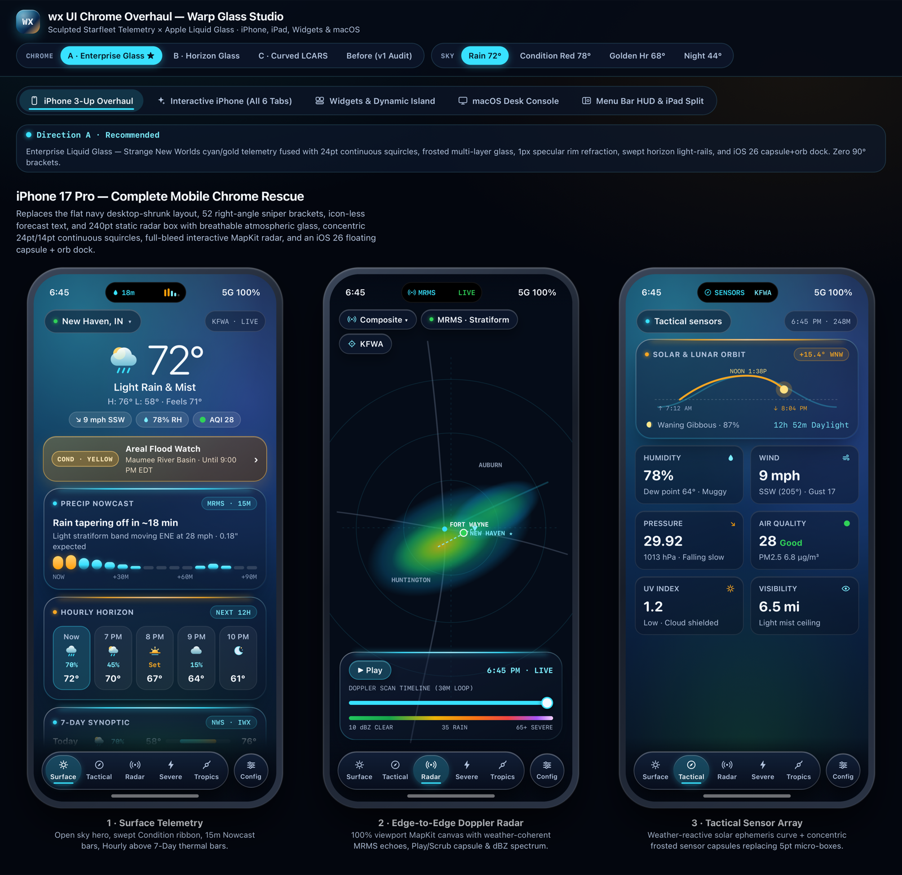
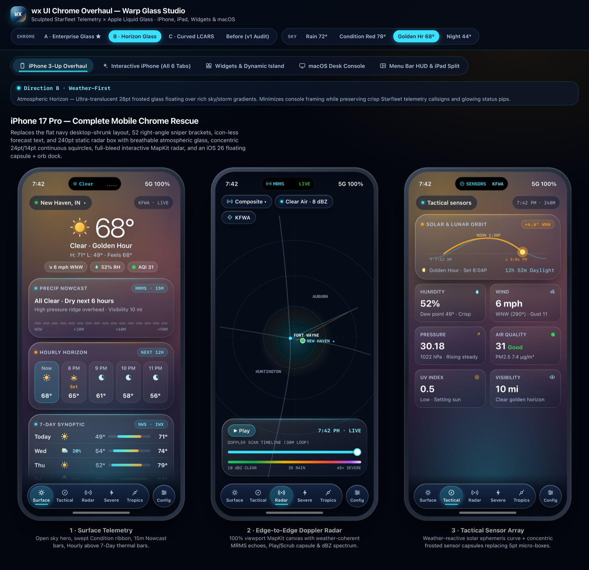
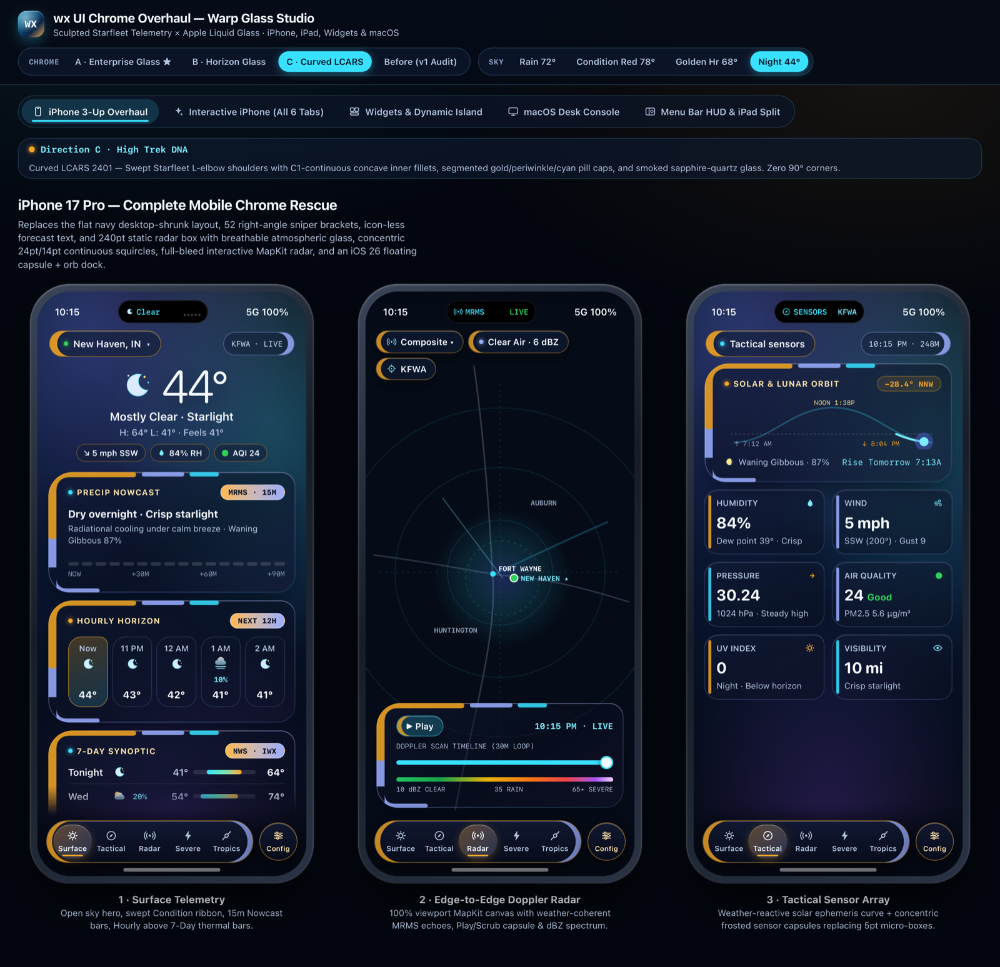
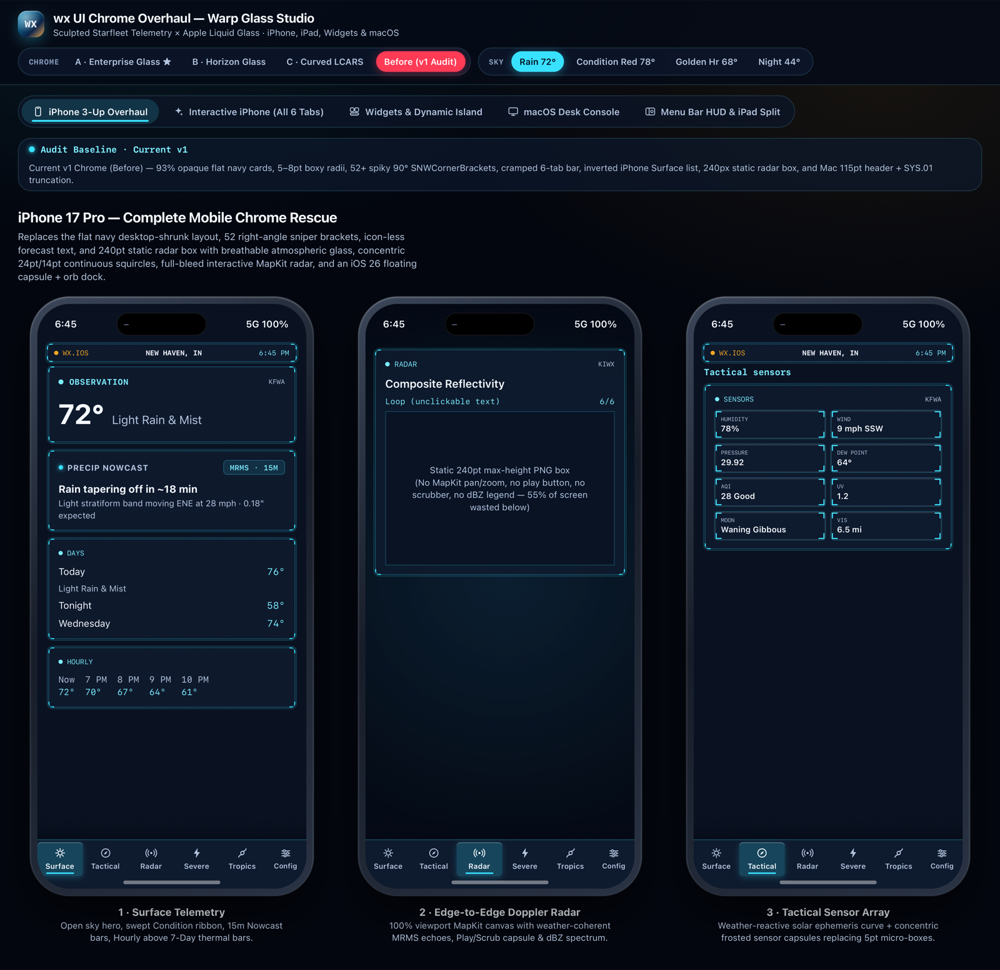
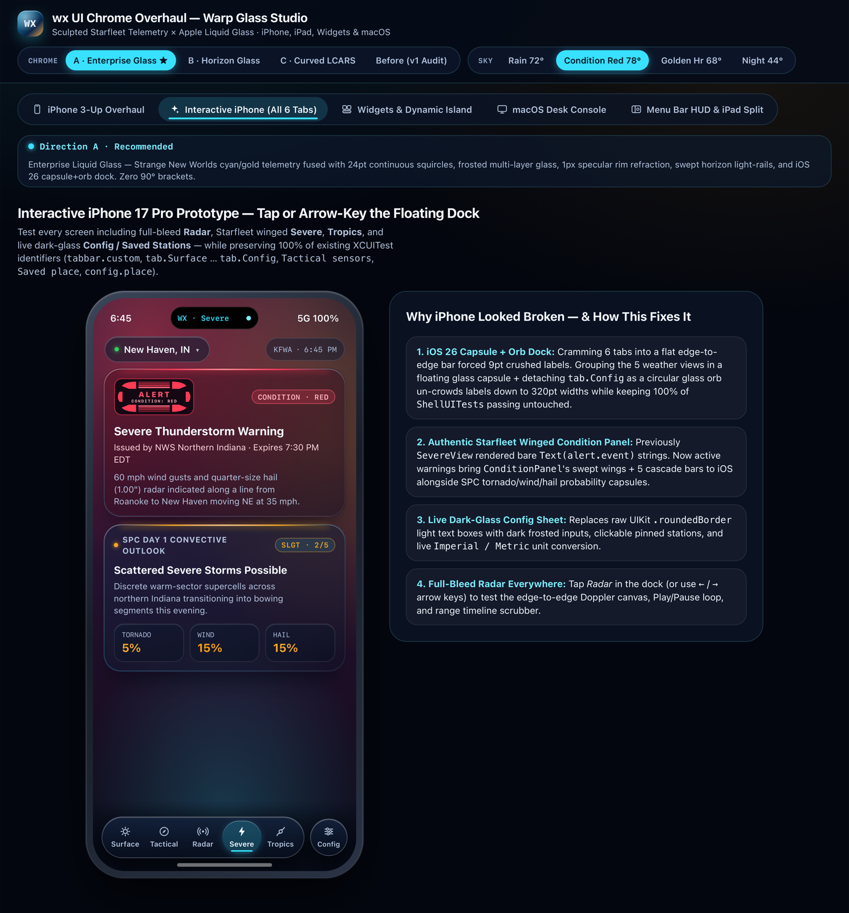
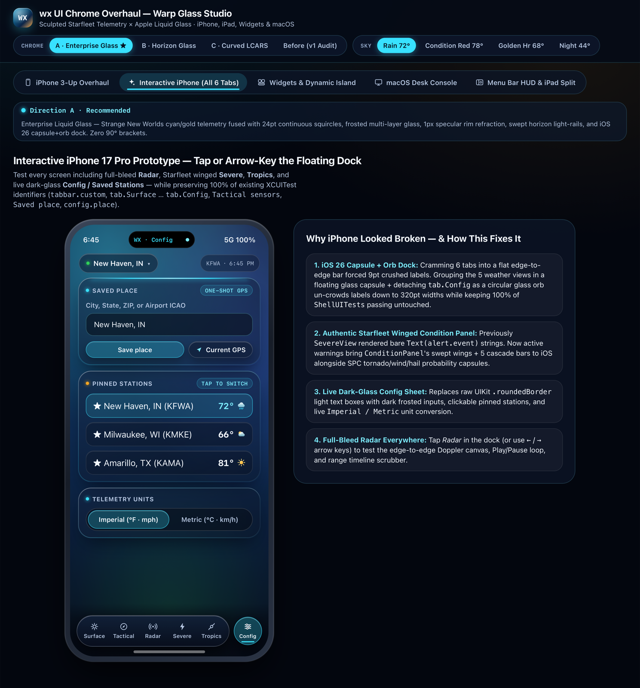
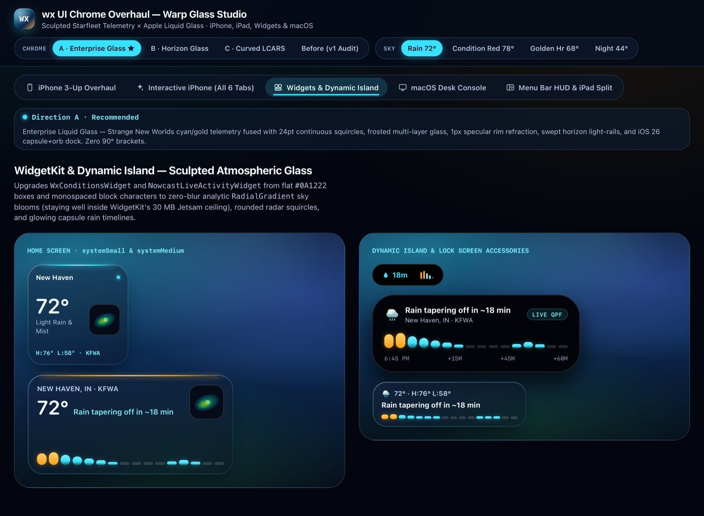
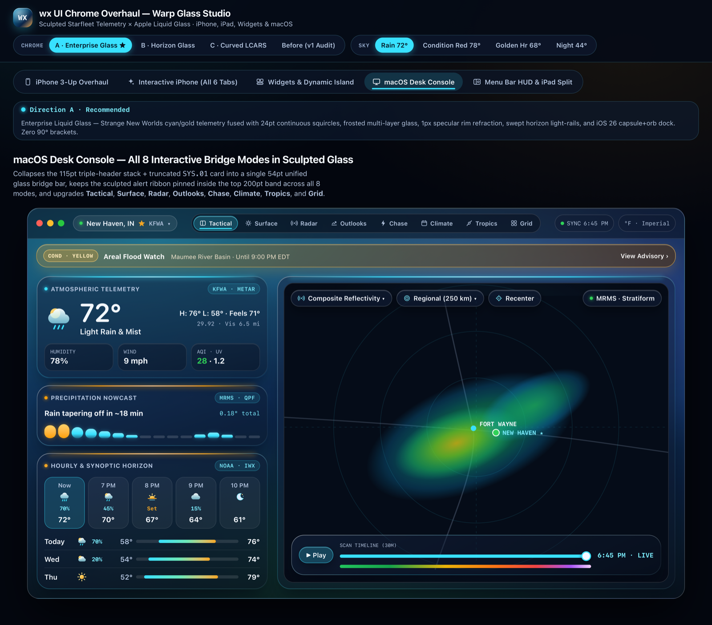
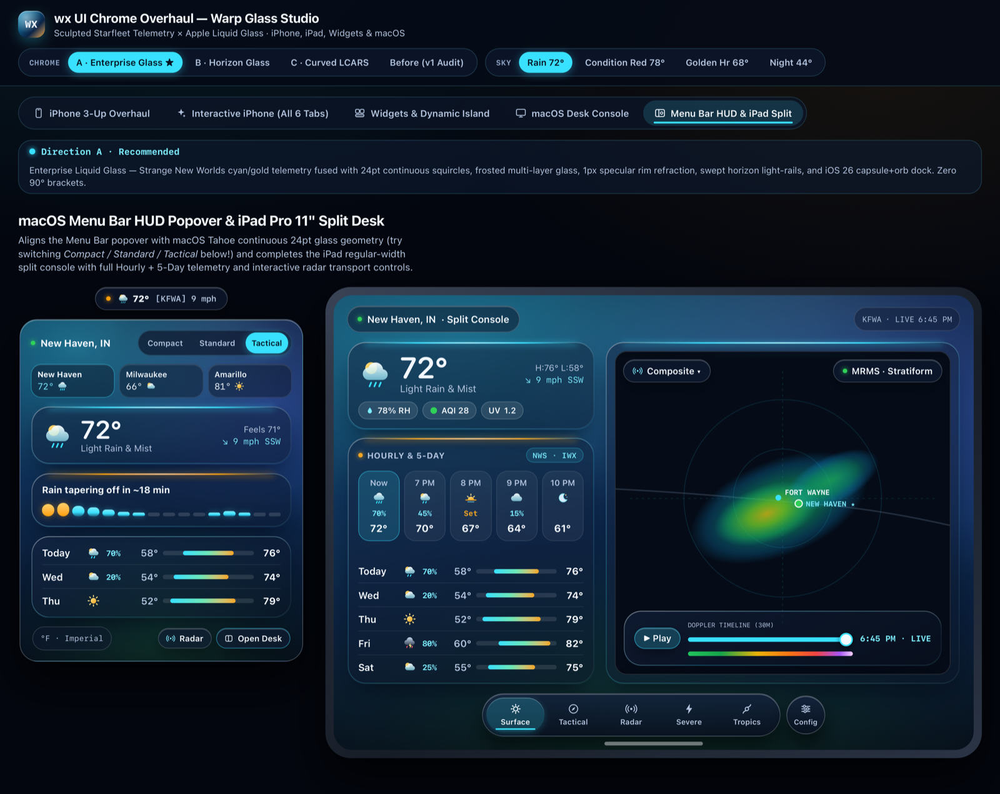

# wx — UI Chrome Review & "Warp Glass" Overhaul Specification

**Status:** Full-Repo UI Chrome Audit + Interactive Web Mock Studio + Verified Multiplatform SwiftUI Prototype  
**Scope:** iPhone & iPad (`ios/WxIOS`), WidgetKit & Dynamic Island (`ios/WxWidget`), macOS Desk (all 8 modes), Menu Bar HUD & Settings (`macos/WxMac`), Bubbletea TUIs (`internal/monitor`, `internal/radar`), Linux Fyne Parity (`linux/internal/ui`)  
**Interactive Mock Studio:** [`docs/mocks/ui-chrome-overhaul/index.html`](mocks/ui-chrome-overhaul/index.html)  
**SwiftUI Reference Primitives:** [`docs/mocks/ui-chrome-overhaul/WxGlassThemePrototype.swift`](mocks/ui-chrome-overhaul/WxGlassThemePrototype.swift)

---

## 0. Branch Hygiene Gate Before Implementation Slices

Before launching implementation slices, reconcile local `main` with `origin/main`:
- Local `main` (`a806d79`) is **1 commit ahead** (`.grok/agents/*` roster doc update) and **26 commits behind `origin/main` (`60241cd`, `v1.3.2`)**.
- All iOS sources (`ios/WxIOS`, `ios/WxWidget`, `ios/WxIOSUITests`) and recent macOS views (`AlertBannerView.swift`, `MCPSettingsView.swift`, `SettingsWindowController.swift`) live on `origin/main`.
- **Slice `UI-0`:** Rebase or cherry-pick `a806d79` onto `origin/main` (`v1.3.2`) before editing Swift views so no work branches off pre-iOS `main`.

---

## 1. Forensic Review of Current `wx` UI Chrome (Full Surface Area)

### 1.1 Shared Theme & Optical Stack (`macos/WxMac/Services/WxTheme.swift`)

| Defect | Exact Source Location | Visual & UX Consequence |
| :--- | :--- | :--- |
| **90° Sniper-Scope Corner Brackets** | `SNWCornerBrackets` (`WxTheme.swift:72–107`) overlaid on `SNWConsoleCard`, `SNWHeaderPill`, `SNWMetricTile`, `RadarPanelView`, `AlertsListView` | Sharp right-angle `Path` corners (`(0,0)`) sit *outside* `RoundedRectangle` arcs, visually canceling rounded corners and producing spiky double-corner artifacts. `NowBlockView` renders 13 tiles inside 1 card = **56 right-angle brackets in a single card**. |
| **Stiff Non-Concentric Micro-Radii (`0pt–8pt`)** | `WxTheme.corner = 8`, `SNWHeaderPill` = `6`, `SNWMetricTile` = `5`, chips = `2–4`, `AlertBannerView` = `0pt` (`Rectangle()`) | Reads like a boxy 2012 industrial terminal rather than sculpted Starfleet glass or Apple Liquid Glass. Outer (`8pt`) and inner (`5pt` with `10pt` padding) radii are non-concentric, and `AlertBannerView` (`origin/main`) uses an unrounded sharp `Rectangle()`. |
| **Smothered "Fake Glass"** | `WxTheme.bg` (`opacity: 0.96`), `snwPanel` (`opacity: 0.88`), `WarpGlassBackground` (`WxTheme.swift:6–8, 243–254`) | Painting 96% opaque `#060A14` under `.ultraThinMaterial` and 88% opaque flat `#0E1A2D` on cards blocks light refraction completely. Cards have zero blur, zero top-leading specular rim highlight, and zero atmospheric color bloom behind them. |
| **Sub-9pt ALL-CAPS `//` Overload** | `6.5pt–9.5pt` `.monospaced` uppercase across headers, tiles, chips, and footers | Good as sparse telemetry callsigns, exhausting when 80% of all text is `7.5pt–8.5pt` uppercase with `//` separators — and fixed `.system(size:)` ignores Dynamic Type accessibility on iPhone. |

---

### 1.2 Why `ios/WxIOS` Looks Terrible on iPhone (`origin/main` Audit)

1. **Desktop Shrink-Ray Shell (`ios/WxIOS/Views/IOSRootView.swift:12–52, 205–238`)**:
   - `WxTheme.snwChassis.ignoresSafeArea()` paints a dead flat `#0A1222` rectangle across the entire OLED viewport — zero sky gradient, zero weather mood, zero glass depth.
   - `SNWHeaderPill(..., badge: "WX.IOS")` drops a `6pt`-corner `9pt`-monospaced Mac status bar at the top of an iPhone screen.
   - **Cramped 6-Tab Flat Strip (`tabBar`)**: Squeezes 6 tabs (`Surface`, `Tactical`, `Radar`, `Severe`, `Tropics`, `Config`) into an edge-to-edge `#0E1A2D` rectangle (~65pt/tab on Pro, ~53pt/tab on 320pt Slide Over) with `9pt` labels (`minimumScaleFactor(0.7)`), `15pt` icons, a harsh `0.5pt` cyan line, and no active capsule pill.
2. **Barebones, Inverted `SurfaceView` (`ios/WxIOS/Views/SurfaceView.swift:242–376`)**:
   - **Trapped Hero Observation**: Current conditions sit inside a boxy `SNWConsoleCard` instead of breathing against an atmospheric sky canvas. Missing **High / Low**, **Feels Like**, and quick **Wind / Humidity / AQI** pills.
   - **Backwards Forecast Order**: `dayList` ("Days") is stacked **above** `hourlyStrip` ("Hourly") (`lines 256–257`). Mobile users check the next 12 hours before next week.
   - **Icon-Less Hourly & Day Lists**: `hourlyStrip` (`lines 350–375`) renders *only* two monospaced strings (`3 PM` and `72°`) — **zero weather icons, zero precip `%`, zero sunrise/sunset markers**. `dayList` (`lines 320–348`) stacks `period.name` + `72°` + unaligned blurb text with **zero icons, zero low/high pairing, zero thermal range bars, and zero row separators**.
   - **Stripped Nowcast**: Renders only headline + summary text — omitting the 15-minute precipitation intensity spark-bars already implemented on macOS (`NowcastTimelineBarsView`).
3. **Broken 240pt Static `RadarTabView` (`ios/WxIOS/Views/OtherTabs.swift:464–517`)**:
   - Places radar inside a `ScrollView` → `SNWConsoleCard` → static `Image` with `.interpolation(.none)` capped at **`maxHeight: 240`** (~28% of the screen, leaving ~60% of the iPhone viewport blank dark navy).
   - `Text(store.loopPlaying ? "Loop" : "Held")` and `Text("1/6")` (`lines 487–495`) are **unclickable plain text**: there is no Play/Pause button, no scrubber, no interactive MapKit base map, no radar product selector, and no dBZ color legend.
4. **Unstyled UIKit Debug `ConfigView` & Raw `SevereView` (`OtherTabs.swift:519–662`)**:
   - `ConfigView` drops a raw `.textFieldStyle(.roundedBorder)` (rendering a jarring light/gray UIKit box on dark navy), raw `.pickerStyle(.segmented)`, and left-aligned `.borderedProminent` / `.bordered` buttons onto naked `#0A1222` background with no saved-favorites list.
   - `SevereView` (`lines 550–556`) renders NWS warnings as bare `ForEach(alerts) { Text(alert.event) }` — discarding the Starfleet `ConditionPanel`, alert headline, expiry, and SPC tornado/wind/hail probabilities.
5. **Flat `WxConditionsWidget` (`ios/WxWidget/WxConditionsWidget.swift`)**:
   - Solid `#0A1222` background, `4pt` radar corner radius, and unicode sparkline characters (`▂▃▅`) instead of zero-blur `RadialGradient` sky blooms, continuous squircle radar thumbnails, and glowing capsule bars.

---

### 1.3 macOS Desk Shell, Menu Bar Popover & Tactical Sub-Cards (`macos/WxMac`)

1. **115pt Triple-Header Bloat + Truncated Location Input (`DeskWindowView.swift:13–92`)**:
   - Stacks three separate full-width horizontal bars (traffic-light status row + `WX.DESK ATMOSPHERIC TELEMETRY CONSOLE` box + 8-button rectangular mode bar) *plus* a `SYS.01 TACTICAL SENSOR CONTROL` card in the left column where **`Amarillo, T` visibly truncates** inside a cramped `LocationBarView`.
   - Collapsing these into a **single 54pt Unified Bridge Glass Toolbar** (Traffic lights + Location Capsule w/ `★` & GPS + Floating 8-Mode Segmented Pill + Live Sync & `°F/°C` pills) reclaims ~60pt of vertical workspace and eliminates the truncated `SYS.01` card entirely while keeping `AlertBannerView` pinned in the top 200pt band across all desk modes.
2. **Popover Corner Clip, Menu Bar Emoji Pips & Box Soup (`PopoverView.swift:34`, `StatusItemController.swift:63–70`)**:
   - Clipping `PopoverView` to `cornerRadius: 8` fights macOS `NSPopover`'s continuous `14–20pt` window mask, while nested `SNWHeaderPill` + `SNWConsoleCard` + `SNWCornerBrackets` crowd a `380pt` HUD.
   - `StatusItemController.swift:63–70` (`pipGlyph`) injects raw OS color emojis (`"🔴 "` and `"🟠 "`) directly into `NSStatusItem.button.title`, rendering mismatched glossy emoji balls in the macOS system menu bar instead of a crisp AppKit palette symbol or vector status dot.
3. **Tactical Sub-Cards & Control Micro-Boxes (`AirQualityCardView.swift`, `EphemerisCardView.swift`, `NowcastCardView.swift`, `WeatherViews.swift`, `LocationViews.swift`, `RadarPanelView.swift`)**:
   - `AirQualityCardView` (`lines 15–125`) wraps EPA AQI inside `SNWConsoleCard` (4 right-angle corner brackets) + `4pt` rounded inner advisory boxes (`RoundedRectangle(cornerRadius: 4)`) + `8pt–9.5pt` monospaced text, though `AQISpectrumBar` already gives a solid continuous meter foundation.
   - `EphemerisCardView` (`lines 7–120`) renders solar progress as a flat horizontal bar (`solarArcMeter`), stacks `4pt` `horizonChip` boxes, and drops a raw `🌖` OS color emoji (`line 104`) instead of a smooth Bézier horizon sine curve and vector lunar glyph — and `NowBlockView` (`WeatherViews.swift:145–150`) similarly injects `astro.moonPhaseIcon` (`🌑..🌘` from `internal/astro/moon.go:111–129`) into its `Moon` `MetricChip`.
   - `LocationBarView` (`LocationViews.swift:80`, `cornerRadius: 6`), `RadarProductMenu` / `RadarCoverageMenu` (`RadarPanelView.swift:51, 112`, `cornerRadius: 5` with `PRODUCT //` & `SCALE //`), and `NowcastCardView` (`lines 60, 76`, `cornerRadius: 4` status/phase tags) fragment toolbar/card controls into stiff 4–6pt boxes instead of concentric `Capsule()` pills.

---

### 1.4 Remaining macOS Desk Consoles & Settings Window (`macos/WxMac/Views/*`, `SettingsWindowController.swift`)

| Surface | Exact Audit Findings | v2 Warp Glass Overhaul Treatment |
| :--- | :--- | :--- |
| **`CommandGridView.swift`** (`lines 75–492`) | Custom `8pt` flat `snwPanel` header bar (`line 161`), `6pt` flat `addStationBar` (`line 214`), `3pt–4pt` micro-buttons/alert tags (`PIN TO GRID`, `TACTICAL`, `RADAR`, `presetButton` at `lines 206, 340, 373, 487`), and `SNWConsoleCard` per city (24 right-angle corner brackets for 6 pinned cities) with `7pt–9pt` monospaced metrics. | Upgrade city cards to `WxGlassCard`, replace `addStationBar` with a frosted pill input + capsule `Pin to Grid` button, convert `HUM / WIND / BARO` and `Tactical / Radar` jump links to concentric `Capsule()` pills, and replace `.monospaced` `32pt` city temps with `.rounded` numerals + vector weather symbols. |
| **`StormChaseView.swift`** (`lines 14–744`) | Uncarded top header row; `SNWConsoleCard` wrappers on `spcSection`, `SoundingConsoleCard`, and every `clusterCard`; `2pt–5pt` micro-boxes (`dayRiskPill` uses `cornerRadius: 2` & `4` at `lines 299, 309`; `SoundingMetricCell` uses `cornerRadius: 3` at `line 742`; `cellRow` uses `cornerRadius: 4` at `line 525`); `7.5pt–9pt` ALL-CAPS monospaced prose. | Upgrade SPC Outlook, Sounding, and Cluster cards to `WxGlassCard`; render `Day 1–3` SPC categories and `Intercept Radar` / `Load Sounding` as luminous `Capsule()` pills; upgrade `SoundingMetricCell` (`SBCAPE`, `0–6km Shear`, `SRH`, `PWAT`) to concentric `WxSensorCapsule` tiles; switch MCD/cell prose to readable `.sans` (`12pt`). |
| **`ClimateTrendsView.swift`** (`lines 73–782`) | Custom `8pt` flat `snwPanel` header & `climateNormalsCard` (`lines 129, 226`); `6pt` inner `snwChassis` boxes (`todayNormalsPanel`, `recordsPanel`, `monthlyNormalsPanel`, `kpiCard` at `lines 285, 314, 339, 440`); `3pt` `BarMark` radius (`line 577`); rigid fixed-column `observationsTable` (`75pt / flex / 95pt / 65pt / 65pt` at `lines 618–685`) with `8pt–9pt` monospaced rows. | Replace the `7D / 14D / 30D` box toggle with a frosted segmented `Capsule()`; upgrade KPI & 30-year normals panels to `WxGlassCard` + `WxSensorCapsule`; round `BarMark` caps (`cornerRadius(6)`) and smooth `LineMark` (`interpolationMethod(.catmullRom)`); give `observationsTable` subtle translucent row hover/striping and `.rounded` H/L figures. |
| **`CPCOutlookView.swift`** (`lines 108–347`) | `SNWConsoleCard` wrappers on `patternShiftCard`, `horizonCard`, and `droughtCard` with `3pt–4pt` probability/shift chips (`lines 184, 247`) and `8.5pt` monospaced prose; already uses `Capsule()` probability meters (`lines 255–269`). | Swap `SNWConsoleCard` → `WxGlassCard` and `shiftTag` / `% PROB` badges → `Capsule()` pills while retaining the glowing `Capsule()` probability bars and upgrading body summaries from `8.5pt` `.monospaced` to `12.5pt` `.sans`. |
| **`TropicsView.swift`** (`lines 128–445`) | `SNWConsoleCard` cyclone and invest cards with `3pt–4pt` inner boxes (`tropicsMetricCell` uses `cornerRadius: 3` at `line 443`; `formationPill` uses `cornerRadius: 3` at `line 182`; invest rows use `cornerRadius: 4` at `line 163`) and `7.5pt–9pt` monospaced advisories. | Swap `TropicalStormCard` & `disturbancesSection` to `WxGlassCard`, upgrade 4-cell cyclone metrics (`Max Winds`, `Pressure`, `Movement`, `Heading`) to `WxSensorCapsule`, and convert `Track & Cone`, `Radar`, `48h/7d` formation chances, and basin outlook links to `Capsule()` pills. |
| **`SettingsWindowController.swift` & `MCPSettingsView.swift`** (`origin/main`) | Dedicated `580×640` `NSWindow` (`identifier: "wx-settings-window"`) hosting a native SwiftUI `Form` with `.formStyle(.grouped)` (`MCPSettingsView.swift:32–103`), selectable monospaced loopback URLs (`127.0.0.1` / `localhost`), and explicit `presentForUserAction()` focus guard. | **Preserve native `.formStyle(.grouped)` intentionally.** macOS Settings (`⌘,`) should remain a clean native AppKit/SwiftUI grouped form (automatic Tahoe continuous squircle group insets, Dynamic Type, text selection, and `SettingsWindowUITests` / `FocusStealUITests` invariants) — do **not** inject `WxAtmosphereCanvas` or custom HUD chrome into `SettingsWindowController`. |

---

### 1.5 Bubbletea Terminal UIs (`internal/monitor`, `internal/radar`) & Linux Fyne (`linux/internal/ui`)

1. **`wx monitor` Bubbletea TUI (`internal/monitor/render.go:24–634`)**:
   - **Hard-Edged Unframed Split**: `renderHeader()` draws a raw edge-to-edge `─` line (`line 131`), and `renderSplit()` (`lines 145–157`) concatenates `padToWidth(leftLines[i], leftW) + rightLines[i]` with **no vertical column divider**, causing weather text to butt directly against ANSI radar half-block pixels.
   - **Harsh Full-Width Block Banners & Square Gauges**: `renderAlerts()` (`line 197`) and `renderSignals()` (`lines 220, 226`) paint full-width solid ANSI background bars (`160` red, `24` blue, `130` brown), and `Air:` (`line 387`) renders raw `■■□□` blocks.
   - **Ambiguous-Width OS Emojis in Terminal Cells**: Uses multi-byte color emojis (`🔄` at `line 219`, `⚡` at `line 224`, `☀️` / `🌙` with variation selectors at `lines 335, 337`) that frequently misalign column widths (`lipgloss.Width` vs terminal glyph advance) across Kitty, Ghostty, iTerm2, and SSH sessions.
2. **`wx radar --interactive` Bubbletea TUI (`internal/radar/interactive.go:353–468`)**:
   - **Unstyled Loading & Layout-Shifting Error Line**: Loading (`lines 374–393`) centers plain unstyled text with manual `\n` loops, and `if m.err != nil` (`lines 403–406`) appends an unpadded `Error: ...` string immediately before `m.helpBar()` without accounting for `renderH = m.height - 1`, pushing or wrapping the bottom help bar.
   - **Narrow-Terminal Wrap Bug in `helpBar()` (`lines 414–468`)**: Joins up to 9 pipe-delimited `│` segments (`p:Composite Reflectivity │ +/-:500km (mosaic · 12 sites) │ 1-5:scale │ l:loop 1/6 │ ←→:step │ space:pause │ <>:speed 600ms │ r:refresh │ q:quit` ≈ **135 columns**) with **no `truncateStr(..., m.width)` guard**, wrapping onto 2–3 lines in an `80×24` or `100×30` terminal pane and scrolling the top radar row off-screen.
3. **CLI Pretty Output (`internal/output/*.go`) & Terminal-Appropriate "Rounded Telemetry" Direction (Optional Slice `UI-6`)**:
   - One-shot CLI pretty renderers (`internal/output/pretty.go:26,33,40`, `aqi.go:30`, `spc.go:26,30`, `icons.go`) already use `lipgloss.RoundedBorder()` (`╭─╮╰─╯`) and clean 5-line ASCII weather art, though `spc.go:67` (`🚨`), `chase.go:65` (`⚡`), and `astro.go` (`🌑..🌘` via `internal/astro/moon.go:111–129`) still emit multi-byte OS color emojis in TTY mode.
   - Terminals cannot perform GPU backdrop blur, so TUI/CLI chrome parity translates "less rectangular, cohesive Starfleet telemetry" into **`lipgloss.RoundedBorder()` (`╭─╮╰─╯`)** panels/headers, truecolor-adaptive `WxGlassTheme` accents (`#38E1FF` cyan, `#F5A623` gold, `#FF3B56` red, `#8CA1C1` muted), a clean `│` split gutter in `wx monitor`, `truncateStr(bar, m.width)` width clamping + inline status/error slot in `interactive.go`, capsule-style keycap pills, and single-width geometric Unicode glyphs (`☀`, `☾`, `◆`, `▲`, `●`, `▰▱`) instead of OS color emojis — while keeping all `internal/monitor/render_test.go`, `internal/radar/interactive_test.go`, and `internal/output/*_test.go` assertions (and `--json` schemas) untouched.
4. **Linux Fyne Parity (`linux/internal/ui/theme.go`, `desk.go`, `surface.go`)**:
   - `linux/internal/ui/theme.go` shares the exact hex tokens (`#060A14`, `#0A1222`, `#0E1A2D`, `#38E1FF`). Overriding `Theme.Size(theme.SizeNameInputRadius)` / `SizeNameSelectionRadius` from default `4pt` to `12pt`, softening card border alpha (`0x38, 0xE1, 0xFF, 0x38`), and adopting the single-row desk mode bar in `desk.go` aligns Linux without Cgo shader hacks.

---

## 2. Three Aesthetic Mock Directions

Open [`docs/mocks/ui-chrome-overhaul/index.html`](mocks/ui-chrome-overhaul/index.html) in Safari, Chrome, or Firefox to toggle live between all three directions, **Before (v1 Audit)**, four meteorologically coherent weather regimes (*Rain 72°* stratiform echoes, *Condition Red 78°* 65+ dBZ supercell, *Golden Hour 68°* +4.6° WNW clear-air sweep, *Night 44°* -28.4° below-horizon UV 0 starlight sweep), live **Imperial / Metric** units, pinned stations, and all 5 platform stages including **all 8 interactive macOS Desk modes** (responsive down to `320px`).

### Direction A (Recommended): **Enterprise Liquid Glass (`snw-glass`)**
Fuses *Strange New Worlds* bridge telemetry DNA (luminous cyan `#38E1FF`, attention gold `#F5A623`, condition red `#FF3B56`, authentic winged `ConditionPanel`, crisp station callsigns, custom SF/Starfleet vector iconography) with **concentric `24pt / 12pt` continuous squircles**, multi-layer `.ultraThinMaterial` over weather-reactive analytic sky blooms, `1pt` top-leading specular refraction rims, and **swept tapered horizon light-rails (`WxHorizonRail`)** instead of 90° corner brackets.

### Direction B: **Atmospheric Horizon Glass (`atmos-glass`)**
Dialed toward pure Apple Weather × Liquid Glass: higher translucency (`24%` card tint overlay, `36pt` blur, `28pt / 16pt` concentric squircles) letting golden-hour, storm-indigo, and daytime sky gradients take center stage, while keeping subtle Starfleet status pips and monospaced METAR badges.

### Direction C: **Curved LCARS 2401 (`lcars-curved`)**
Unmistakable 25th-century Starfleet Glass LCARS (`Picard` / *Strange New Worlds* bridge evolution): **swept Starfleet L-elbow shoulders (`WxLCARSElbowOverlay`) with C1-continuous `16pt` & `12pt` concave inner circular fillets**, horizontal spine segmentation gaps, segmented **gold (`#F5A623`) + periwinkle (`#9AAEFF`) + cyan (`#38E1FF`)** rounded pill-cap header bars, asymmetric sculpted curves (`34/30/24/20pt`), and smoked sapphire-quartz glass (`54%` tint, `30pt` blur) — zero sharp 90° corners anywhere inside or out.

### Baseline Comparison: **Legacy v1 Chrome (`Before`)**
Forensic side-by-side baseline reproducing the flat `#0E1A2D` boxes, 90° `SNWCornerBrackets`, inverted icon-less `Days` above `Hourly`, static 240pt radar box, bare 8-tile `Tactical sensors` box, flat 6-tab strip, and Mac 115pt triple-header + `SYS.01` truncation.

---

## 3. Additional Platform Mock Renders (Direction A)

### 3.1 iPhone Rescued `Severe` (`ConditionPanel` Red) & Live Dark-Glass `Config`

### 3.2 Home Screen Widgets, Lock Screen & Dynamic Island

### 3.3 macOS Desk Console — Single 54pt Bridge Bar + Pinned Alert Ribbon + All 8 Interactive Modes

### 3.4 macOS Menu Bar HUD Popover & iPad Pro 11" Split Console (Hourly + 5-Day + Interactive Radar)

---

## 4. Design System Overhaul Specification (v1 Rectangular SNW → v2 Warp Glass)

Reference SwiftUI implementation verified against `macosx` and `iphonesimulator` SDKs plus live `NSHostingView` layout tests at `320pt`/`375pt`/`430pt` across Dynamic Type (`large`, `xxxLarge`, `accessibility3`): [`WxGlassThemePrototype.swift`](mocks/ui-chrome-overhaul/WxGlassThemePrototype.swift).

| Token / Primitive | v1 Rectangular SNW (`WxTheme.swift`) | v2 Warp Glass (`WxGlassTheme`) |
| :--- | :--- | :--- |
| **Window / Screen Canvas** | Flat `#0A1222` (`snwChassis`) or `#060A14` @ `96%` opacity | `WxAtmosphereCanvas`: Deep obsidian `LinearGradient` + 2 analytic `RadialGradient` weather blooms (`rain`, `severe`, `goldenHour`, `orbitalNight`, `clearDay`) — **zero offscreen `Circle().blur()` textures** so WidgetKit stays well below its `30 MB` Jetsam limit and 120Hz scrolling stays GPU-cheap |
| **Card Material** | Flat `#0E1A2D` @ `88%` opacity (no blur) | `.ultraThinMaterial` + direction-specific tint overlay (`42%` Enterprise, `24%` Horizon, `54%` Curved LCARS) |
| **Corner Geometry** | `8pt` card, `6pt` pill, `5pt` tile, `0pt` alert banner | True concentric `.continuous` squircles ($R_{\text{inner}} = \max(10, R_{\text{outer}} - 12)$): **`24pt / 12pt` iOS (`20pt / 10pt` Mac)** in Enterprise, **`28pt / 16pt`** in Horizon, **`UnevenRoundedRectangle(34/30/24/20)`** in Curved LCARS, **`Capsule()`** pills & docks |
| **Edge Framing** | Uniform `0.8pt` cyan border + 4 sharp 90° `SNWCornerBrackets` | **Delete `SNWCornerBrackets`**. Use `1pt` diagonal specular rim gradient + `2pt` tapered top `WxHorizonRail` (Direction A) or swept `WxLCARSElbowOverlay` with C1-continuous concave inner fillets & segmented gold/periwinkle/cyan pill bars (Direction C) |
| **Iconography** | Missing in iOS forecast strips; raw OS color emojis (`🌖`, `🔴`, `🟠`, `🚨`, `⚡`) in `EphemerisCardView`, `NowBlockView`, `StatusItemController` & TUIs/CLI | Cohesive SF Symbols (`symbolRenderingMode(.hierarchical)` / `.palette`, `moonphase.*`) on Apple platforms + crisp vector SVG symbols in web mocks + single-cell Unicode glyphs in TUIs — zero opaque square OS emoji tiles |
| **Text Contrast** | `#F0F6FF` primary / `#94A7C5` secondary / `#64748B` tertiary | `#F3F8FF` (`16.34:1`), `#B4C5DF` (`9.96:1`), `#8CA1C1` (`6.2:1`) — all WCAG AA compliant over translucent dark glass |
| **Typography & Dynamic Type** | Fixed `6.5pt–9.5pt` `.system(size:)` `.monospaced` ALL CAPS (ignores Dynamic Type) | `@ScaledMetric`-backed `.rounded` display/metrics (`62pt` hero, `20pt` sensor values, `13.5pt` forecast), `.sans` body, `.monospaced` reserved strictly for callsigns/timestamps; dock clamped via `.dynamicTypeSize(...DynamicTypeSize.xxxLarge)` + `ViewThatFits` |
| **iPhone Navigation & Scroll Clearance** | 6-item flat edge-to-edge `#0E1A2D` bar (`9pt` cramped labels) | `WxFloatingTabDock` (**5-tab frosted `Capsule` + detached `52×52pt` circular glass `Config` orb**) paired with `.wxDockScrollClearance()` (`safeAreaPadding(.bottom, 128)` + `LinearGradient` mask reaching `0%` alpha **`6pt` above the `76pt` dock top rim** and `100%` alpha **`6pt` below max-scrolled content** so scrolling text never bleeds behind dock labels or stops inside the fade) |
| **macOS Desk Header** | 3 stacked full-width bars (~115pt) + `SYS.01` card | Single **54pt Unified Bridge Glass Toolbar** integrating traffic lights, location capsule, 8-mode pill bar, live sync badge, and unit toggle |

---

## 5. XCUITest, Go Test & Accessibility Preservation Matrix

Every existing UI and TUI test suite continues to pass without weakening or deleting a single assertion:

| Test Suite | Required Identifiers & Assertions | How v2 Warp Glass Preserves It |
| :--- | :--- | :--- |
| `ios/WxIOSUITests/ShellUITests.swift` | `app.tabBars.count == 0`, `tabbar.custom` exists, no `More` button, `desk.split` absent on iPhone; taps `tab.Surface`, `tab.Tactical`, `tab.Radar`, `tab.Severe`, `tab.Tropics`, `tab.Config`; asserts exact static texts **`"Tactical sensors"`** (`TacticalView`) and **`"Saved place"`** (`ConfigView`) plus `app.textFields["config.place"]` | `WxFloatingTabDock` wraps both the 5-pill capsule and the detached circular `Config` orb inside a single container tagged `.accessibilityIdentifier("tabbar.custom")`; `TacticalView` keeps its `"Tactical sensors"` section title (`tactical.root`) and `ConfigView` keeps its `"Saved place"` card header (`config.saved`) + `config.place` dark-glass `TextField`. |
| `ios/WxIOSUITests/PadSplitUITests.swift` | `desk.split`, `desk.telemetry`, `desk.radar`, `surface.root`, `radar.root` exist simultaneously on regular-width iPad | Adaptive iPad split view keeps all 5 `.accessibilityIdentifier(...)` hooks strictly in accessibility metadata (never leaked into visible user labels) while upgrading panes to complete Hourly + 5-Day `WxGlassCard`s, interactive radar scrubber chrome, and a centered `460pt` floating glass dock. |
| `ios/WxIOSUITests/PowerUITests.swift` & `LiveActivityUITests.swift` | `power.*` (`loopTicks`, `loopState`, `frameCount`, `fetchCount`, `clock.advance`) and `live.*` (`status`, `id`, `inject.onset`, `inject.dry`) when `WX_UI_TEST=1` | Keep env-gated test probes tucked cleanly below the top location pill only when `showsPowerProbe` / `showsLiveProbe` is enabled. |
| `macos/WxMacUITests/AlertBannerUITests.swift` | `alert-banner`, `alert-banner-warning` / `alert-banner-watch`, `alert-banner-details` popover on click, `frame.minY <= windowFrame.minY + 200` on **every** desk tab including `.radar` | Upgrade `AlertBannerView` from sharp `Rectangle()` to `WxSculptedAlertRibbon` (crimson for `.warning`, Starfleet gold/amber for `.watch`) with human-facing `"View Advisory ›"` copy and `.accessibilityIdentifier("alert-banner")`, pinned immediately below the 54pt Bridge Toolbar (`minY ~ 62pt`, well inside `200pt`) across all 8 desk modes. |
| `macos/WxMacUITests/LocationDeniedUITests.swift`, `RadarRefreshUITests.swift`, `SettingsWindowUITests.swift`, `FocusStealUITests.swift` | `wx.location`, `wx.hourly.strip`, `wx-settings-window`, `mcp-*` controls, `⌘,`, non-activating HUD launch | Location capsule keeps `wx.location`; Hourly card keeps `wx.hourly.strip`; `AppDelegate` activation policy, `SettingsWindowController`, and `MCPSettingsView`'s native `.formStyle(.grouped)` remain untouched. |
| `internal/monitor/render_test.go` & `internal/radar/interactive_test.go` | Exact line-count budgeting (`m.height`), split-view rendering, forecast scroll header, keybindings (`r`, `R`, `H`, `l`, `s`, `p`, `+/-`, `1-5`, `q`) | Any optional TUI polish (`Slice UI-6`) preserves exact row counts (`headerLines` + `contentH` + `helpBarLines`) and all keybindings while clamping `helpBar()` width to `m.width`. |

---

## 6. Recommended Lead-Sized Implementation Slices

1. **`UI-0` — Sync `main` with `origin/main` (`v1.3.2`)**
   - Rebase local `.grok/agents/*` commit `a806d79` onto `origin/main` (`60241cd`) and verify `make test && make vet`, `macos` build, and `ios` simulator build.
2. **`UI-1` — Shared `WxTheme` v2 ("Warp Glass" Primitives)**
   - Replace `SNWCornerBrackets` and opaque `snwPanel` in `WxTheme.swift` with `WxAtmosphereCanvas` (analytic `RadialGradient` blooms), `WxGlassCard`, `WxHorizonRail`, `WxLCARSElbowOverlay`, `WxSensorCapsule`, `WxThermalRangeBar`, and `.wxDockScrollClearance()` (from `WxGlassThemePrototype.swift`), shared between `macos/` and `ios/`.
3. **`UI-2` — iPhone Shell, `SurfaceView` & Floating Capsule+Orb Dock**
   - Upgrade `IOSRootView.swift` (`WxAtmosphereCanvas` + floating location pill + `.wxDockScrollClearance()` + `WxFloatingTabDock`) and `SurfaceView.swift` (open sky hero with H/L & Feels Like, sculpted Condition Red/Yellow alert ribbon, 15m Nowcast capsule spark-bars, Hourly with SF Symbols & precip `%` promoted *above* 7-Day thermal range bars) + complete regular-width iPad Split Desk (`Hourly` + `5-Day` + radar transport).
4. **`UI-3` — iPhone Full-Bleed Interactive `RadarTabView`**
   - Port `RadarMapView` (`MKMapView` / SwiftUI `Map` overlay) to iOS so radar fills 100% of the viewport behind floating frosted Product/Scale pills and a floating Play/Scrub + dBZ glass capsule, while preserving `radar.root`, `radar.product`, `radar.transport`, `radar.frame`, and `radar.image` / map overlay hooks.
5. **`UI-4` — iPhone `Tactical`, `Severe`, `Tropics`, Dark-Glass `Config` & Widgets**
   - Add weather-reactive Bézier solar orbit card + `WxSensorCapsule` grid to `TacticalView` (preserving `"Tactical sensors"`); bring Starfleet `ConditionPanel` + SPC probability capsules to `SevereView`; replace raw UIKit `ConfigView` with dark-glass `"Saved place"` search + pinned favorites; upgrade `WxConditionsWidget` & `NowcastLiveActivityWidget` using zero-blur `RadialGradient` backgrounds (`< 30 MB` Jetsam safe).
6. **`UI-5` — macOS Unified Bridge Toolbar, All 8 Desk Views, Menu Bar HUD & Linux Fyne Alignment**
   - Collapse `DeskWindowView`'s 3-bar header + `SYS.01` card into the single 54pt Bridge Glass Toolbar, upgrade `AlertBannerView` to `WxSculptedAlertRibbon` pinned across all 8 modes, migrate `AirQualityCardView`, `EphemerisCardView`, `CommandGridView`, `StormChaseView`, `ClimateTrendsView`, `CPCOutlookView`, and `TropicsView` onto `WxGlassCard` / `WxSensorCapsule` / `Capsule()` (leaving `SettingsWindowController` / `MCPSettingsView` native `.grouped`), align `PopoverView` with continuous `20–24pt` glass geometry, and bump `linux/internal/ui/theme.go` radii (`12pt`) + single-row desk bar parity.
7. **`UI-6` (Optional Additive) — Bubbletea TUI Rounded Telemetry Polish (`internal/monitor`, `internal/radar`)**
   - Add a clean `│` split divider and single-width geometric Unicode glyphs (replacing ambiguous-width OS emojis) in `internal/monitor/render.go`, clamp `internal/radar/interactive.go`'s `helpBar()` to `m.width` so `80×24` loop mode never wraps, and align lipgloss accent tokens with `WxGlassTheme`.
